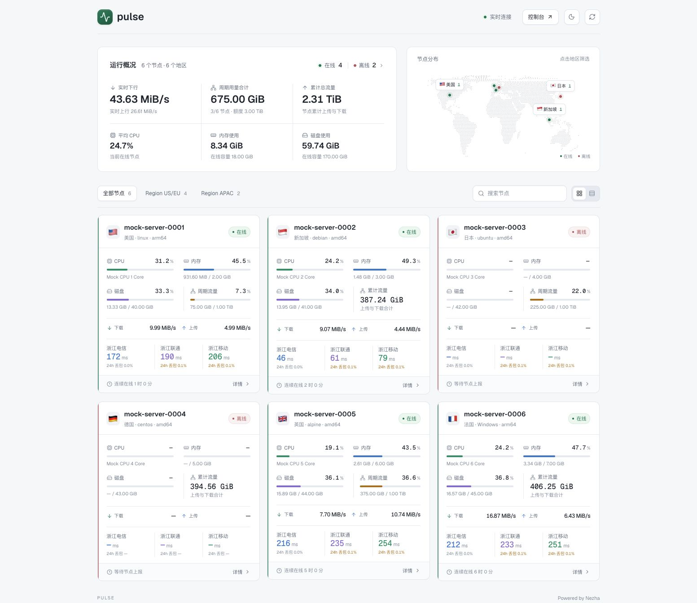
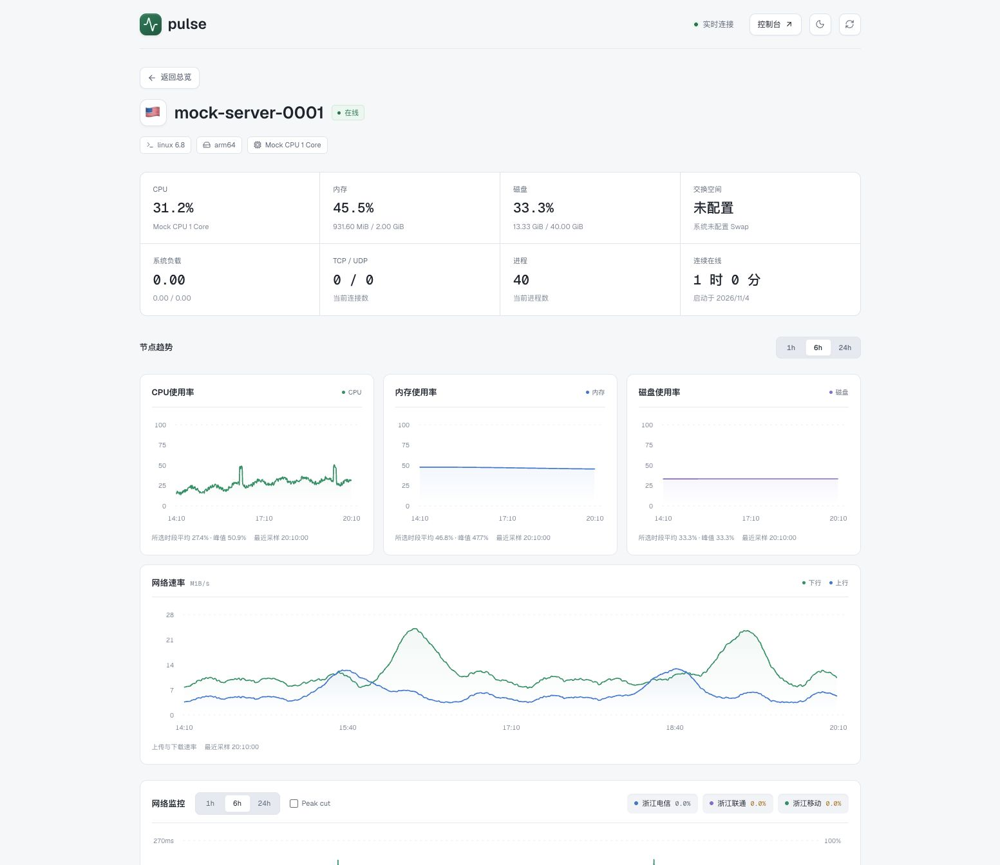

# Pulse

[](https://github.com/davaded/pulse-nezha-theme/actions/workflows/ci.yml)
[](LICENSE)

Pulse 是面向 **Nezha V2** 的用户前端主题，基于官方推荐的 [nezha-dash-v2](https://github.com/hamster1963/nezha-dash-v2) 开发。首页采用平面点阵地图、节点卡片和全局指标，详情按单页展示，不分 Tab。

- 首页支持分组、搜索、在线筛选，以及卡片和列表视图；整张节点卡片可点击，支持键盘与新标签页打开。
- 展示 CPU、内存、磁盘、网络速率、周期流量、累计流量和连续在线时间。
- 详情需登录后查看，CPU、内存、磁盘独立成图；支持 1h / 6h / 24h、网络延迟与丢包、线路切换、仅看与 Peak cut。
- 宽屏内容最大 1120px，三列卡片约 363px，适配笔记本与手机；支持浅色、深色和系统配色。
- 采用面板同源 API 与 WebSocket，无需在前端填写 API Token。

当前版本为 **0.1.0**，已完成新版界面、访问交互与模拟后端的本地验证，并在真实 V2.6.1 面板确认同源登录与空节点列表。该面板尚无可验收的节点，真实资源、网络与计费数据仍待验证。本轮修改尚未部署，截图使用模拟数据。



<details>
<summary>查看单页详情预览</summary>



</details>

## 开发与构建

需要 Node.js 22+、pnpm 11+；打包脚本需要系统提供 `zip`。

```sh
git clone https://github.com/davaded/pulse-nezha-theme.git
cd pulse-nezha-theme
pnpm install --frozen-lockfile
pnpm dev:mock
```

浏览器打开 `http://localhost:5173/`。默认模拟后端在 8008 端口。模拟功能只由开发脚本提供，生产文件中没有内置示例节点或模拟 API。

```sh
pnpm dev:mock:guest               # 访客场景
MOCK_NEZHA_TSDB=0 pnpm dev:mock  # 未开启历史存储
MOCK_NEZHA_COUNT=0 pnpm dev:mock # 空节点列表
pnpm verify                     # 格式、测试/覆盖率、类型、生产构建
pnpm package:theme              # 构建并生成 artifacts/dist.zip
```

打包文件内的顶层目录为 `dist/`，内含 `index.html`、`assets/`、字体、图标与许可证。`dist.zip.sha256` 可校验文件完整性。

## 连接真实面板

生产环境直接使用当前面板同源的 `/api/v1/` 和 `/api/v1/ws/server`，保留 Cookie 登录和后端权限控制。不需要在主题里填 Token 或修改 API 地址。

本地开发可以连接本机 Dashboard（默认 `http://localhost:8008`），也可以通过环境变量指定目标：

```sh
NEZHA_BACKEND_URL=https://your-panel.example pnpm dev
```

这只改变开发代理。远程面板的登录 Cookie 不会自动转移到 localhost；完整的登录、强制鉴权与私有节点验证应在真实面板的同源安装环境中进行。不要把面板凭据写入前端代码、URL 或构建环境。

## 安装与回退

遵循 [官方主题开发文档](https://nezha.wiki/developer/theme-development.html) 的本地目录覆盖方式：

1. 记录当前面板版本、`user_template` 设置，以及实际工作目录；完整备份原来的主题目录。
2. 解压 `artifacts/dist.zip`。将 **dist 内的全部内容**放入面板工作目录里所选主题对应的覆盖目录。例如面板选择 `user-dist`，应得到 `user-dist/index.html` 与 `user-dist/assets/`；不要放成 `user-dist/dist/index.html`。
3. 容器安装需把该完整目录挂载到 Dashboard 容器实际工作目录下的同名位置。工作目录和挂载路径以你的安装配置为准。
4. 在面板选择该安装包中合法注册的用户主题名。随意填写 `pulse` 或一个目录路径不会注册新主题。
5. 按官方要求重载/重启服务并刷新浏览器，检查首页、直接访问 `/server/实际节点ID`、登录与退出、后台 `/dashboard/`，以及静态资源是否正常。

不要把新旧两次构建的散落文件混用。回退时恢复整份原主题目录和原 `user_template` 设置，再按面板要求重载。此项目的构建、预览和打包命令不操作面板服务。

## 数据与显示规则

| 内容 | 数据来源与行为 |
| --- | --- |
| 节点、CPU、内存、磁盘、连接数、进程、连续在线 | 官方 WebSocket；离线或缺少字段显示 `—`，真实零值保留 |
| 全局资源 | 只统计当前可见且在线的节点；累计传输汇总可见节点 |
| 周期流量 | `/api/v1/service` 的周期规则；卡片与汇总每个节点只统计主规则，避免重复计算；没有规则的显示累计流量且不绘制额度条；详情保留全部规则 |
| 资源、网络速率历史 | 检查 `tsdb_enabled`，获取 `period=1d` 后按服务端时间筛选 1h/6h/24h；前台每分钟刷新，显示最近采样时间；内存、磁盘按当前容量换算百分比 |
| 未开启 TSDB | 仅显示本次访问保留的最多 30 个 WebSocket 样本，并注明实时采样；不是持续历史 |
| 网络监控 | 节点服务接口；延迟折线、后端提供的丢包面积、线路切换与 Peak cut；首页丢包标明 24h 窗口；没有丢包字段显示 `—`，不根据延迟猜测 |
| 在线记录 | 官方 online-history；登录后的详情请求 7 天，采用面板返回的实际窗口和时区 |
| 地图 | 根据国家/地区代码显示大致分布；无法确定地区的节点保留在列表中 |

所有时间范围的空数据、请求失败、断线都单独显示；历史曲线按时间戳连接，保留缺口。页面支持重试。变更登录身份时清除节点、历史和公开备注缓存，重新建立 WebSocket。

WebSocket 连续 30 秒没有有效消息时标为“数据已过期”并自动重连；重新连接成功后，收到有效数据才解除过期状态。页面恢复焦点时也会检查数据是否停更，保留最近接收时间供查看。

一个节点可能命中多个周期流量规则。默认采用接口返回的第一条匹配规则；可在自定义代码中指定主规则，键为服务器 ID，值为 `cycle_transfer_stats` 中的规则 ID：

```html
<script>
  window.PulsePrimaryCycleIds = { "1": "8", "2": "12" };
</script>
```

卡片、首页“周期用量合计”与详情的主规则标记保持一致。指定规则不存在时回退到第一条匹配规则；汇总注明覆盖的节点数，各节点的计费起止时间可能不同，不能理解为统一自然月账单。无周期规则时详情省略周期卡片，保留累计流量与在线记录。

首页每次展示 24 张卡片，按需加载更多，避免大量节点同时请求网络历史。地图和全局统计仍包含后端返回的全部可见节点。宽屏内容最大 1120px，手机切为单列；支持浅色、深色与系统配色。

## 详情访问与登录

访客可以查看后端公开的首页总览。点击节点或直接打开 `/server/:id` 时，主题先检查 `/api/v1/profile`；未登录时展示登录入口，不挂载详情组件或请求详情历史。

登录入口在新标签页打开原面板 `/dashboard/`，沿用官方账号、Cookie 与登录方式。完成登录后回到原节点页，主题会重新确认会话；也可以点击“检查登录”。过期或退出后，详情重新显示登录提示。

这是主题的访问交互；后台已公开的数据接口仍由后台配置控制。需要数据保密时，使用哪吒的访客隐藏设置或 `force_auth`；后者同时限制访客访问首页数据。规则见 [官方 API 文档](https://nezha.wiki/guide/api.html)。

## 浙江三网监控

先在 Dashboard 服务监控中创建三个 ICMP 任务，选择需要执行探测的服务器：

| 任务名称 | 探测目标 |
| --- | --- |
| 浙江电信 | `zj-ct-v4.ip.zstaticcdn.com` |
| 浙江联通 | `zj-cu-v4.ip.zstaticcdn.com` |
| 浙江移动 | `zj-cm-v4.ip.zstaticcdn.com` |

目标来自 [公开节点清单](https://github.com/ischanx/nezha-service-import/blob/main/public/ipv4.json)，2026-11-05 已确认 DNS 能解析，尚未从用户服务器验证 ICMP 和长期稳定性。主题不会创建探测任务，也不会在浏览器中直接 ping 这些域名。

任务使用上表中的完整名称时，首页优先按电信、联通、移动展示已有的数据。更可靠的方式是在面板自定义代码中绑定实际任务 ID：

```html
<script>
  // 替换成你后台的实际监控 ID，依次为电信、联通、移动。
  window.PulseMonitorIds = [1, 2, 3];
</script>
```

绑定 ID 后，只展示匹配到的任务，缺少数据不使用其他任务顶替。详情仍保留全部后端可见线路，并将绑定线路排在前面。未绑定且没有浙江任务时，首页展示后端前三条任务的实际名称，不将其改名成三网。本地预览中的浙江三网曲线为模拟数据。

## 可选公开备注与自定义代码

普通 `public_note` 按纯文本显示。兼容常见主题的 `planDataMod` / `billingDataMod` JSON：详情显示有效的带宽、流量、IPv4/IPv6、线路与额外备注；到期日期由备注提供，卡片在 14 天内提示，未提供时不生成。

Pulse 不自动推算续费后的到期日期，请维护备注里的实际日期。普通备注中的 HTML 不会执行。

保留官方的 `custom_code` 注入和清理机制。当前 Pulse 读取 `ForceTheme`、`CustomBackgroundImage`、`CustomLogo`、`ForcePeakCutEnabled`、`PulseMonitorIds` 和 `PulsePrimaryCycleIds`。其他 nezha-dash 专用的布局开关或自定义 DOM 选择器没有承诺兼容；修改主题后应复核原有自定义代码。

## 实际面板验收

本地模拟和自动化检查不能替代真实安装验收。还需在你的面板上确认：访客/成员/管理员的可见节点、`force_auth`、登录退出、TSDB 开关、实际探测线路、周期计费规则、容器覆盖路径和节点详情刷新。

源码：`src/features/pulse/`。保留的原始界面源码用于上游回归测试，生产入口 `src/main.tsx` 使用 Pulse 应用。

项目基础代码为 Apache-2.0，详情视觉借鉴 [Lotus](https://github.com/fl0w1nd/Lotus) 并保留 MIT 声明；字体为 SIL OFL。见 [NOTICE](public/NOTICE.txt)、[LICENSE](LICENSE) 与 `public/licenses/`。上游原文档保存在 `docs/UPSTREAM_README.md`。

公开仓库从清理后的源码快照建立，基于上游提交 `1dd038b`（v2.7.0），保留原始许可证与署名。上游开发证书、个人配置、依赖目录和本地构建产物不纳入源码。界面方向见 [docs/DESIGN.md](docs/DESIGN.md)，验证记录见 [docs/VALIDATION.md](docs/VALIDATION.md)。
